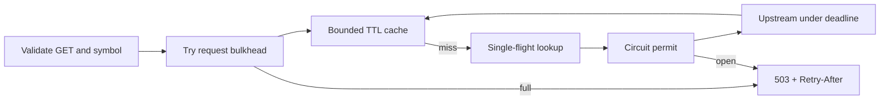

# Latency Gateway

A Java 21 HTTP quote-lookup gateway that bounds active request work and prevents repeated lookups from overwhelming an upstream. It combines virtual threads, a bounded TTL/LRU cache, single-flight loading, an upstream deadline, and a circuit breaker with one recovery probe.

**Portfolio focus:** latency-sensitive JVM services, concurrency correctness, resilience, measurable performance, and Kubernetes operations. Default prices and failures are synthetic; this is a systems demonstration.

## Run

Requires JDK 21+ and Python 3. No application libraries are required.

```sh
./scripts/test.sh
./scripts/run.sh
```

In another terminal:

```sh
curl -i 'http://localhost:8080/quotes?symbol=DEMO'
curl -i 'http://localhost:8080/quotes?symbol=DEMO'
curl http://localhost:8080/metrics
python3 scripts/benchmark.py --requests 10000 --concurrency 32 --symbols 20
```

The first response has `X-Cache: MISS`; a repeat has `HIT`. Concurrent misses for the same symbol share one upstream request and return `SINGLE_FLIGHT`. `SLOW` exercises the timeout; `FAIL0` through `FAIL4` exercise upstream failure and circuit opening. Cached values remain available during a circuit outage until their TTL expires.

## Request flow



Generation-tagged circuit permits stop old successes/failures from changing a newer circuit state. The cache holds at most 256 entries; no symbol appears in a metric label. The request semaphore admits at most 64 active quote handlers, including waiters on an existing load. Overflow is rejected with HTTP 503. HTTP parsing and virtual-thread dispatch occur before the semaphore, so this is an application-work bulkhead, not a total socket or memory cap.

## Configuration

| Variable | Default | Purpose |
|---|---|---|
| `PORT` | 8080 | HTTP listener |
| `MAX_IN_FLIGHT` | 64 | Active quote work limit |
| `UPSTREAM_TIMEOUT_MS` | 120 | Loader deadline |
| `CACHE_TTL_MS` | 2000 | Cache lifetime; 0 disables reuse |
| `CACHE_CAPACITY` | 256 | Maximum cache entries |
| `MOCK_DELAY_MS` | 30 | Synthetic backend delay |
| `UPSTREAM_URL` | unset | Optional real HTTP quote endpoint |

The HTTP upstream receives `?symbol=...` (or an appended query argument). It must return JSON on HTTP 200. The gateway accepts at most 65,536 response-body bytes, counting actual incoming bytes for both fixed-length and chunked responses. It cancels the response subscription when the next batch would exceed that limit, before forwarding that batch to the String accumulator. This byte limit also rejects multibyte text whose character count is below 65,536. A body exactly at the limit is accepted.

Oversized, truncated and non-200 responses return HTTP 503 and never enter the cache. The JDK handler retains its charset selection and decoding behavior. The limit bounds accumulated payload bytes; transport buffers, decoded Strings and concurrent requests consume additional memory. It does not validate a JSON schema or limit accepted inbound connections. Deadline cancellation requires the upstream operation to honor interruption; cancellation is not a guarantee that arbitrary external work has stopped. The synthetic backend and JDK HTTP call support interruption. See [the response-body decision](docs/adr-upstream-body-limit.md).

## Measured results

[BENCHMARK.md](BENCHMARK.md) contains actual runs with identical workload parameters, raw reports, hardware/runtime context, and limitations. The benchmark reports client-observed p50/p95/p99 for both all responses and successes, status counts, cache outcomes, and throughput. Its results are local measurements, not SLOs or production capacity.

Prometheus-compatible histograms use fixed buckets. `/health/live` indicates the process serves HTTP; `/health/ready` becomes unavailable during shutdown. Readiness deliberately stays healthy during an upstream outage so the breaker can recover and cached requests can continue to serve. Alert on 503s, timeouts, rejection rate and circuit state instead of restarting on upstream errors.

## Deploy example

```sh
docker build -t latency-gateway:1.0.0 .
helm lint helm/latency-gateway
helm template demo helm/latency-gateway
helm upgrade --install demo helm/latency-gateway
```

Use an image registry or load the image into your local cluster first. The chart includes CPU/memory settings, probes, Prometheus annotations, non-root execution, a read-only root filesystem, and a shutdown grace period. The default upstream remains synthetic. TLS/authentication, network admission limits, autoscaling, and real upstream credentials belong in a deployment-specific configuration.

Six Java checks verify cache expiration/bounds, single-flight concurrency, circuit generations/recovery, timeout cancellation, byte-boundary decoding and overflow cancellation. HTTP tests cover input validation, cache headers, deadlines, circuit opening/recovery, bulkhead rejection, health endpoints and metrics, plus real upstream fixed-length/chunked bodies, multibyte byte limits, interrupted responses and failure caching. Helm lint and template rendering pass. Docker and Kubernetes deployment were not executed locally. See [the concurrency ADR](docs/adr.md), [the operating runbook](docs/runbook.md) and [the development walkthrough](docs/development-2026-10-10.md).
